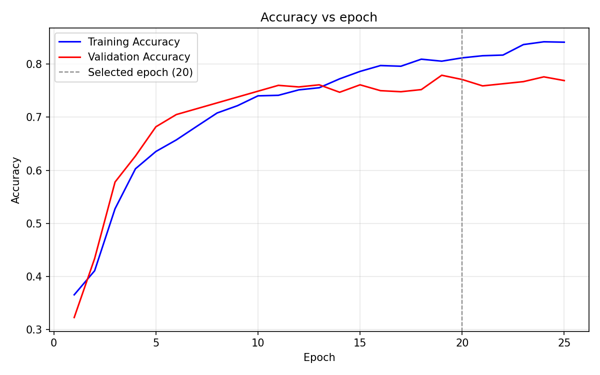
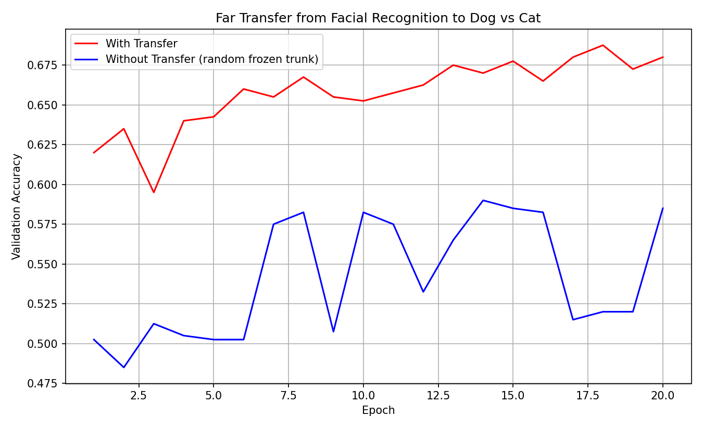

# FacialGame

Play tic-tac-toe with your face. A small Keras CNN reads one of three facial expressions from
your webcam (**happy**, **neutral** or **surprise**), and each expression selects a row or a
column on the board.

The project then tunes the classifier with a staged hyperparameter search. It also tests
whether the features the classifier learned from faces help with an unrelated task: telling
dogs from cats.

This is a team project for P6, *Using Learning to Create a Novel Game Controller*, in a UC
Santa Cruz Game AI course.

## Results

| | Test accuracy |
|---|---|
| Facial expressions, 3 classes (target ≥ 70%, ≤ 150k parameters) | **75.69%** with 124,195 parameters |
| Dog vs Cat **with** transfer from the face model | **63.0%** |
| Dog vs Cat **without** transfer (randomized frozen trunk) | 54.5% |

<p align="center">
  
  
</p>

What the experiments found:

- **The optimizer and dropout produced all of the gain.** Switching from RMSprop to Adam added
  3.3 points, and dropout added 1.6. Changing the number of convolutional or fully connected
  layers never beat the baseline. In the architecture stage, every variant with a fifth
  convolutional block did worse than every 4-block variant.
- **Dropout only helped as a pair.** Dropout after the convolutions alone, or before the output
  alone, each scored *below* the model with no dropout. Using both layers together gave the best
  result of the search.
- **Transfer depends on which layer you cut at.** The assignment says to transfer everything
  except the final softmax, which means transferring the 64-unit bottleneck. Doing that showed no
  effect (+1.75 points, within noise). Cutting one layer earlier, at the 1,568-unit convolutional
  features, gave a clear effect (+8.5 points) and met all four of the assignment's transfer
  criteria.
- **`trainable = False` does not turn off Dropout.** A frozen trunk that contains dropout layers
  keeps dropping activations while the new head trains, unless the trunk is called with
  `training=False`. In the first transfer run this flattened both learning curves to chance
  level.

The full write-up is in [`docs/report.md`](docs/report.md) ([PDF](docs/report.pdf)). It covers
every search configuration, the confusion matrix, the learning curves, and model summaries.

## Setup

You need Python 3.11, because TensorFlow 2.12 does not support newer versions.

```sh
python3.11 -m venv .venv
source .venv/bin/activate
pip install -r requirements.txt
```

With [uv](https://docs.astral.sh/uv/), run `uv venv && uv pip install -r requirements.txt`.
uv picks up the Python version from `.python-version`.

The trained classifier is committed in `results/models/`, so you can play the game right away.
Training and evaluation need the datasets, which are not committed. See
[`data/README.md`](data/README.md) for how to get them.

## Playing the game

```sh
python src/run.py
```

You need a webcam and a display. You play O against a random player (X). On each of your turns:

1. The terminal lists which expression selects which row: `0` = happy, `1` = neutral,
   `2` = surprise.
2. A webcam preview opens. Make the expression, then press **Enter** to capture it.
3. The model classifies the frame and shows its guess. Press **Enter** to accept it, or type
   `text` to enter the number by hand.
4. Repeat steps 1–3 for the column.

## Reproducing the results

Every script resolves its paths through `src/config.py`, so you can run it from any directory.

| Command | What it does | Needs data |
|---|---|---|
| `python src/hp_search.py check` | Builds all 14 search configurations and checks each against the 150k parameter budget | no |
| `python src/test_transfer.py` | Checks the transfer wiring on synthetic images (frozen trunk, identical heads, randomized control) | no |
| `python src/finalize_section6.py` | Rebuilds the search table, plots, test metrics and confusion matrix from the saved runs in `results/search/`, without retraining | yes |
| `python src/hp_search.py A` | Runs one stage of the hyperparameter search (`A`, `B`, `C` or `D`) | yes |
| `python src/train.py` | Trains the optimized model; set `name = 'basic_model'` to train the initial network instead | yes |
| `python src/train_transfer.py` | Trains the with-transfer and without-transfer models, then plots their validation curves | yes |
| `python src/class_examples.py` | Saves a grid of example images for each class | yes |
| `python src/show_examples.py` | Shows sample training images, to check the dataset export | yes |

`transfer_feature_layer` in `src/config.py` selects the Section 8 experiment. Set it to `None` to
transfer the bottleneck, or to `'flatten'` (the default) to transfer the convolutional features.

The search was not seeded. When the same configuration ran twice, it scored 74.34% and 73.97%,
so treat differences under about one point as noise.

## Project layout

```
├── src/
│   ├── config.py               paths, dataset sizes, image size, transfer settings
│   ├── preprocess.py           tf.data loaders for both tasks
│   ├── models/
│   │   ├── model.py            base class: train, evaluate, confusion matrix
│   │   ├── basic_model.py      initial CNN
│   │   ├── optimized_model.py  tuned CNN, the search winner
│   │   ├── transfered_model.py frozen facial-expression trunk + new trainable head
│   │   └── random_model.py     the same, with the trunk randomized (control)
│   ├── train.py                train a single model
│   ├── hp_search.py            staged hyperparameter search
│   ├── finalize_section6.py    turn the search runs into report tables and plots
│   ├── train_transfer.py       transfer experiment
│   ├── test_transfer.py        transfer wiring check
│   ├── export_dataset.py       build data/train and data/test from FER2013
│   ├── prepare_transfer.py     build data/transfer from the Cats and Dogs set
│   ├── class_examples.py       example image grids for the report
│   ├── show_examples.py        quick look at the exported training set
│   └── game.py, gui.py, player.py, run.py    tic-tac-toe and the webcam controller
├── results/
│   ├── figures/                plots used in the report
│   ├── models/                 section6_best_model.keras, the classifier the game loads
│   └── search/                 every search run: weights (.keras) + training history (.npy)
├── data/                       datasets, not committed (see data/README.md)
└── docs/                       the report, in Markdown and PDF
```

## Acknowledgments

The course provided the starter code: the tic-tac-toe game and GUI, the webcam player, the model
base class, and the training scaffolding. Facial expression images come from
[FER2013](https://www.kaggle.com/datasets/msambare/fer2013). Dog and cat images come from
Microsoft's Asirra dataset, which is also distributed as Kaggle's *Dogs vs Cats*.
