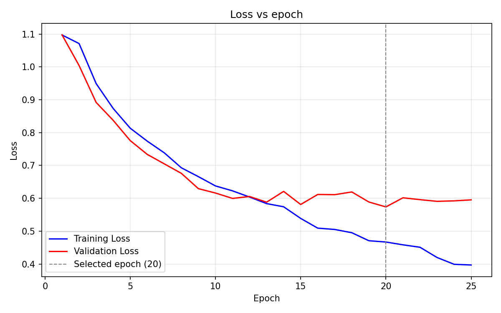
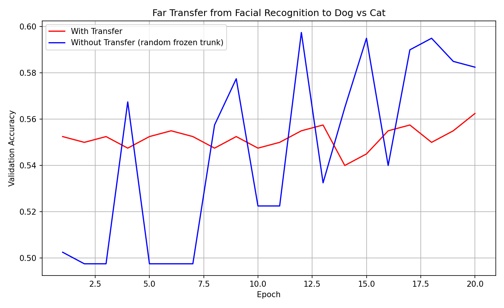
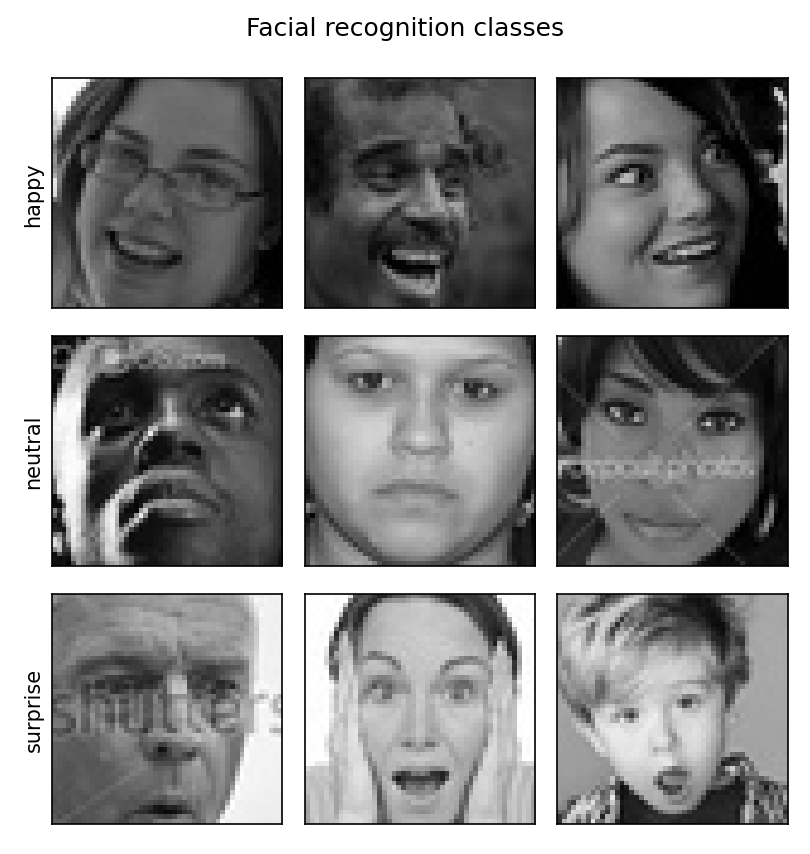
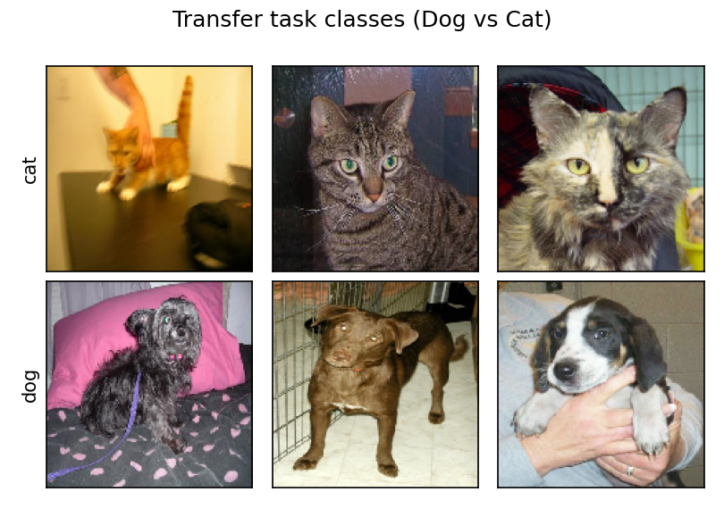

# Report — Hyper-parameter Optimization and Transfer Learning

> This report covers Sections 6 and 8 of the assignment: tuning the facial expression
> classifier, then testing whether its learned features transfer to Dog vs Cat
> classification. See the [README](../README.md) for the project overview and how to
> reproduce every number below.

---

# Section 6 — Hyper-parameter Optimization

## 6.1 Objective

Starting from the Section 4/5 network, search across model-defining hyper-parameters for the
configuration with the best accuracy at the overfitting point, targeting ≥70% accuracy on the
held-back test set.

## 6.2 Experimental setup

All runs share a fixed protocol so that configurations are comparable:

| Setting | Value |
|---|---|
| Training data | 5000 FER2013 images, balanced (1666 happy / 1666 neutral / 1668 surprise) |
| Train/validation split | 80/20 → 4000 train, 1000 validation (`seed=47`) |
| Test data | 3838 held-back images (1774 happy / 1233 neutral / 831 surprise) |
| Input | 150×150 RGB, rescaled to 0–1 by an in-model `Rescaling` layer |
| Batch size | 128 |
| Loss | `categorical_crossentropy` |
| Maximum epochs | 40 |
| Epoch selection | `EarlyStopping(monitor='val_loss', patience=5, restore_best_weights=True)` |
| Parameter budget | ≤150,000 (verified programmatically before each run) |

Using `restore_best_weights=True` means every reported test accuracy is measured at the epoch
of minimum validation loss — that is, the model as it stood immediately before overfitting set
in, as the assignment requires. The epoch selected is reported in the tables as "best epoch".

**Note on the test set.** The test distribution is imbalanced: `happy` alone is 46.2% of it
(1774/3838). A degenerate classifier that always predicts `happy` therefore scores 46%, which
is the floor against which the results below should be read.

## 6.3 Search strategy

An exhaustive grid over four hyper-parameters would require roughly a hundred training runs for
little benefit, since the parameters are largely separable in their effects. We instead ran a
**staged search**: each stage varies one family of hyper-parameters, and the winner of that
stage is fixed as the starting point for the next. This reduced the search to 13 runs while
still covering every hyper-parameter the assignment names.

| Stage | Hyper-parameter varied | Runs |
|---|---|---|
| A | Optimizer and learning rate | 4 |
| B | Number of convolutional layers, number/width of fully connected layers | 5 |
| C | Number, position, and rate of dropout layers | 4 |

The stages are ordered so the cheapest and most influential knob comes first: an unusable
learning rate makes every architectural comparison meaningless, so it is settled before any
architecture is varied.

Every configuration was checked against the 150,000-parameter budget *before* training. One
originally planned configuration (4 convolutional blocks of 16/32/64/64 filters) was rejected
at this check: with only four pooling stages the feature map reaching `Flatten` is 7×7×64, and
the first fully connected layer alone costs over 200,000 parameters, putting the model at
261,475 total. It was replaced with 16/32/32/32 (124,195 parameters).

## 6.4 Results

### Stage A — optimizer and learning rate

Architecture held fixed at the Section 5 network (conv 8/16/32/32, one FC layer of 64 units).

| Configuration | Params | Best epoch | Val acc | Test acc | Test loss |
|---|---|---|---|---|---|
| RMSprop, lr 1e-3 *(Section 5 baseline)* | 115,891 | 13 | 0.7150 | 0.7108 | 0.7096 |
| RMSprop, lr 5e-4 | 115,891 | 17 | 0.7280 | 0.7215 | 0.6756 |
| RMSprop, lr 1e-4 | 115,891 | 40 | 0.6920 | 0.6918 | 0.7468 |
| **Adam, lr 1e-3** | 115,891 | 10 | **0.7450** | **0.7434** | **0.6444** |

**Winner: Adam at 1e-3** — 74.34% test accuracy, and the lowest test loss of the four.

Two observations:

- Adam improved on RMSprop by **3.3 percentage points** while also converging faster (best epoch
  10 versus 13). Adam's per-parameter adaptive moments evidently suit this loss surface better
  than RMSprop's, which is consistent with the RMSprop runs' noisier validation curves.
- The RMSprop 1e-4 run reached its best validation loss at **epoch 40 — the maximum allowed**.
  Early stopping never triggered, which is the signature of a model still improving when
  training was cut off. Its 69.18% is therefore an artefact of an insufficient epoch budget at
  too small a step size, not a genuine ceiling for that learning rate.

### Stage B — network capacity

Optimizer fixed at Adam 1e-3.

| Configuration | Params | Best epoch | Val acc | Test acc | Test loss |
|---|---|---|---|---|---|
| conv 8/16/32/32, FC 64 | 115,891 | 11 | 0.7610 | 0.7397 | 0.6407 |
| **conv 16/32/32/32, FC 64** | 124,195 | 12 | 0.7520 | **0.7408** | 0.6418 |
| conv 16/32/64/64/64, FC 64 | 114,083 | 13 | 0.7560 | 0.7204 | 0.6937 |
| conv 16/32/64/64/64, FC 128 | 130,723 | 12 | 0.7590 | 0.7337 | 0.6802 |
| conv 16/32/64/64/64, FC 128→64 | 138,787 | 12 | 0.7240 | 0.6915 | 0.7453 |

**Winner: 4 convolutional blocks of 16/32/32/32 with a single 64-unit FC layer** at 74.08%.

The dominant finding is that **depth hurt**. All three five-block configurations scored below
all three four-block ones. A fifth convolutional block adds a fifth 2×2 pooling stage, reducing
the final feature map from 7×7 to 3×3; at 150×150 input this discards spatial detail the
classifier still needs, and the discriminative information distinguishing these three
expressions is evidently carried at a finer scale than a 3×3 map preserves.

Adding fully connected capacity on top of the deeper stack did not recover the loss. Widening
the FC layer to 128 units helped slightly (0.7204 → 0.7337) but stayed below every four-block
result, and adding a second FC layer made things worse than any other configuration tested
(0.6915) — the extra parameters went into fitting the training set rather than generalizing.

Widening the convolutional stack within four blocks was neutral: 8/16/32/32 and 16/32/32/32
finished 0.11 points apart, which is inside run-to-run noise (see below).

### Stage C — dropout

Architecture and optimizer held fixed at the stage B winner (conv 16/32/32/32, FC 64, Adam 1e-3).
"After conv" means immediately following the final pooling layer; "before output" means between
the fully connected layer and the softmax.

| Configuration | Params | Best epoch | Val acc | Test acc | Test loss |
|---|---|---|---|---|---|
| 0.5 before output | 124,195 | 14 | 0.7420 | 0.7220 | 0.6706 |
| 0.25 after conv | 124,195 | 12 | 0.7560 | 0.7368 | 0.6506 |
| **0.25 after conv + 0.5 before output** | 124,195 | 20 | **0.7710** | **0.7569** | **0.6122** |
| 0.30 after conv + 0.5 before output | 124,195 | 16 | 0.7530 | 0.7436 | 0.6422 |

**Winner: two dropout layers, 0.25 after the convolutional stack and 0.5 before the output** —
75.69% test accuracy at 124,195 parameters, comfortably inside the 150,000 budget.

Dropout produced the largest single improvement of the search, **+1.6 points** over the best
undropped configuration (74.08%), and it is the only stage C result that clears the run-to-run
noise floor established in §6.5.

The more interesting result is that **two dropout layers were necessary; one was not enough**.
Both single-layer variants scored *below* the no-dropout stage B baseline — 72.20% for dropout
before the output alone, 73.68% for dropout after the convolutions alone. Only their combination
helped. A plausible reading is that this network overfits at two distinct points: the
convolutional stack memorizes texture detail, and the 100,416-parameter fully connected layer
(81% of all parameters in the model) memorizes combinations of those features. Regularizing
either site alone leaves the other free to overfit, while costing the capacity that the
regularized site loses.

Dropout also visibly delayed overfitting rather than merely damping it: the selected epoch moved
from 12 without dropout to **20** with both layers, so the model trains substantially longer
before validation loss turns. The rate mattered but not sharply — raising the convolutional
dropout from 0.25 to 0.30 cost 1.3 points, enough to prefer 0.25 but within a factor of a few of
the noise floor.

## 6.5 Methodological caveat — run-to-run variance

Weight initialization is not seeded in this search. The magnitude of that variance is directly
measurable here: the Adam 1e-3 configuration appears in both stage A and stage B (as the last
row of A and the first of B), and the two independent runs of the identical configuration
scored **0.7434 and 0.7397** — a spread of 0.37 points.

**Differences smaller than roughly one percentage point in these tables should therefore not be
treated as meaningful.** This does not affect the conclusions drawn above, each of which rests
on a gap several times larger than that: Adam over RMSprop is 3.3 points, and the four-block
versus five-block separation is at least 0.6 points with every member of one group beating
every member of the other. It does mean the choice between the two four-block configurations in
stage B is arbitrary on this evidence.

## 6.6 Relationship to the Section 5 result

The Section 5 baseline configuration already reaches **71.08%** on the test set under this
protocol — above the 70% target — without any hyper-parameter change. The reason is epoch
selection alone: early stopping restores the weights from epoch 13, whereas training to a fixed
40 epochs would report a substantially overfitted model. The contribution of the Section 6
search is the additional **4.6 points** on top of that, from 71.08% to 75.69%.

Attributed by stage: the optimizer change contributed roughly 3.3 points, dropout a further 1.6,
and the architectural change essentially nothing (0.1 points, inside the noise floor). It is
worth stating plainly that **two of the four hyper-parameters the assignment names — number of
convolutional layers and number of fully connected layers — did not help this problem.** Every
variation of them we tried either matched the baseline or was worse. The gains came entirely
from the optimizer and from regularization.

## 6.7 Final model

**Optimized Network** — 4 convolutional blocks (16/32/32/32 filters, 3×3, ReLU, each followed by
2×2 max pooling), dropout 0.25, flatten, one 64-unit ReLU fully connected layer, dropout 0.5,
3-unit softmax. Adam at learning rate 1e-3, categorical cross-entropy.

```
Layer (type)                 Output Shape              Param #
=================================================================
rescaling (Rescaling)        (None, 150, 150, 3)       0
conv2d (Conv2D)              (None, 148, 148, 16)      448
max_pooling2d (MaxPooling2D) (None, 74, 74, 16)        0
conv2d_1 (Conv2D)            (None, 72, 72, 32)        4640
max_pooling2d_1 (MaxPooling2D) (None, 36, 36, 32)      0
conv2d_2 (Conv2D)            (None, 34, 34, 32)        9248
max_pooling2d_2 (MaxPooling2D) (None, 17, 17, 32)      0
conv2d_3 (Conv2D)            (None, 15, 15, 32)        9248
max_pooling2d_3 (MaxPooling2D) (None, 7, 7, 32)        0
dropout (Dropout)            (None, 7, 7, 32)          0
flatten (Flatten)            (None, 1568)              0
dense (Dense)                (None, 64)                100416
dropout_1 (Dropout)          (None, 64)                0
dense_1 (Dense)              (None, 3)                 195
=================================================================
Total params: 124,195
Trainable params: 124,195
Non-trainable params: 0
```

**Performance on the held-back test set**, measured on the model as it stood at the epoch of
minimum validation loss (epoch 20):

| Metric | Value |
|---|---|
| Test accuracy | **0.7569** |
| Test loss | **0.6122** |



*Training and validation loss against epoch.*


*Training and validation accuracy against epoch.*

The loss plot shows the overfitting point clearly. Training and validation loss descend together
until roughly epoch 12, after which they separate: validation loss flattens near 0.60 while
training loss continues down to 0.40 by epoch 25. The dashed line marks epoch 20, the validation
minimum, which is the model submitted.

**Confusion matrix** (rows = true class, columns = predicted):

| | pred. happy | pred. neutral | pred. surprise | recall |
|---|---|---|---|---|
| **happy** (1774) | 1282 | 321 | 171 | 72.3% |
| **neutral** (1233) | 196 | 946 | 91 | 76.7% |
| **surprise** (831) | 64 | 90 | 677 | 81.5% |

No class collapsed, which matters given that the test set is 46.2% `happy` — a model that simply
favoured the majority class could post a superficially reasonable accuracy while being useless as
a game controller. Per-class recall is in fact *inversely* related to class frequency here:
`surprise` is the rarest class in the test set yet the best recognized, presumably because an
open mouth and raised brows are a more distinctive visual signature than the subtler differences
between `happy` and `neutral`. The largest single error mode is `happy` misread as `neutral`
(321 cases), which is the confusion one would predict for a weak smile.

The submitted model is `results/models/section6_best_model.keras`.

---

# Section 8 — Transfer Learning

## 8.1 Target task

Far transfer from three-class facial expression recognition to **Dog vs Cat** binary
classification — the Kaggle *Dogs vs Cats* dataset (the Microsoft Asirra collection).

| | Images |
|---|---|
| Training | 2000 (1000 cat, 1000 dog) → 1600 train / 400 validation |
| Test | 400 (200 cat, 200 dog) |

Images are loaded at 150×150 RGB to match the fixed input shape of the frozen network. A small
number of files in the source archive are truncated or not valid JPEGs; these were filtered out
during dataset preparation by decoding every candidate image before accepting it.

The source and target tasks are conceptually unrelated — human facial expression versus animal
species — which is what makes this a *far* transfer test rather than a fine-tuning exercise.

## 8.2 Architecture

Both models are constructed identically apart from the trunk weights:

1. Load the trained Section 6 facial recognition model.
2. Remove the final softmax layer, which is specialized to the 3-class problem.
3. Freeze every remaining parameter so training cannot alter it.
4. Attach a new trainable head: one fully connected layer of 64 ReLU units, then a 2-unit
   softmax output.
5. Train only the new head.

The two conditions differ in exactly one respect:

| | Trunk weights | Trunk trainable? | Head |
|---|---|---|---|
| **With transfer** | Learned on facial expressions | No | Trainable, 4,290 params |
| **Without transfer** | Randomized | No | Trainable, 4,290 params |

Holding the head architecture, optimizer (RMSprop 1e-3), and learning rate identical is what
makes the comparison interpretable: any difference in the learning curves is attributable to
the trunk's weights and nothing else. In the implementation both models are built through the
same `load_trunk()` / `attach_head()` / `compile_head()` functions so the head cannot drift
between conditions.

Both were trained for 20 epochs. Because the trunk is frozen, only the 4,290 head parameters
receive gradients in either condition.

## 8.3 Note on the control condition

The assignment describes the no-transfer control two different ways. The prose in Section 8
describes "training the modified architecture with all parameters randomly initialized, and
available for learning", whereas the comments in the supplied `random_model.py` instruct the
implementer to load the model, **freeze** its weights, and **randomize** them.

**We implemented the version specified in the code comments**: a randomized, frozen trunk with
a trainable head. This isolates the contribution of the *learned features* specifically — both
conditions train exactly the same number of parameters on exactly the same data, so the only
variable is whether the fixed feature extractor was trained on faces or is random noise. The
alternative reading (a fully trainable random-init network) confounds feature quality with
trainable capacity, since that model would be optimizing over 100,000+ parameters against the
transfer model's 4,290.

## 8.4 An implementation detail that matters: freezing does not disable dropout

Our first run produced learning curves flat at chance for both conditions. The cause was that
`trainable = False` freezes a layer's *weights* but does **not** put `Dropout` into inference
mode — dropout follows the `training` flag, not the `trainable` flag. During head training the
frozen trunk was therefore still dropping 25% of its convolutional activations and 50% of its
output on every step. Measured directly on the loaded trunk:

| | Fraction of output that is zero | Repeated passes identical? |
|---|---|---|
| `training=True` | 82.4% | No |
| `training=False` | 63.7% | Yes |

The fix is to invoke the trunk as `trunk(inputs, training=False)`, which is the idiom the Keras
transfer-learning documentation prescribes. All results below use the corrected version. This is
worth recording because the failure is silent: nothing errors, the parameter counts look
correct, and only the flat learning curve reveals that the transferred features were being
destroyed in transit.

## 8.5 Result with the prescribed architecture

Following the writeup literally — eliminate only the final softmax, so the transferred features
are the 64-unit bottleneck:

| | Test accuracy | Test loss |
|---|---|---|
| With transfer | 0.5725 | 0.6990 |
| Without transfer (random frozen trunk) | 0.5550 | 0.6893 |

Both models: 128,290 total parameters, **4,290 trainable, 124,000 non-trainable** — identical in
both conditions, confirming that the freeze took effect and that the two heads are the same size.



*With transfer vs. without, 64-unit bottleneck features. Both curves sit near chance.*

**This configuration does not demonstrate a far transfer effect.** Assessed against the four
criteria:

| Criterion | Met? |
|---|---|
| Increased intercept after epoch 1 | Marginal — 0.5525 vs 0.5025, but the baseline's early epochs are erratic |
| Increased asymptote | **No** — the baseline finishes *higher*, ~0.58 vs ~0.56 |
| Same accuracy in fewer epochs | **No** |
| Higher test accuracy | +1.75 points, which on a 400-image test set is 7 images — inside noise |

The baseline curve oscillates between 0.50 and 0.60 throughout, which is the signature of a
model that is not learning: it is wandering near chance rather than converging. The transfer
curve is flat at 0.55. Neither condition learned the task.

We report this as a null result rather than re-running until a gap appeared.

### Why the prescribed architecture fails here

The 64-unit layer is the network's bottleneck, trained to compress a 150×150 image down to
exactly what separates *happy*, *neutral*, and *surprise*. That is the most task-specific
representation in the entire model. Information irrelevant to facial expression — the shape of
an ear, the texture of fur — is precisely what those 64 units were optimized to discard. A head
placed there is being asked to classify animals from a description of a facial expression.

The generic, transferable features live one layer earlier, in the 1568-unit convolutional output:
edges, textures, and local shapes, which are useful for almost any vision task. This
general-to-specific gradient across depth is a standard finding in the transfer learning
literature, and §8.6 tests it directly.

## 8.6 Follow-up: transferring the convolutional features instead

To test the explanation above, we repeated the experiment with a single change — the trunk is
truncated at the `flatten` layer (1568 units) rather than the bottleneck (64 units), so the
task-specific fully connected layer is discarded along with the softmax. Everything else is
identical: same frozen trunk, same trainable head, same optimizer, same data, same 20 epochs.

This is a slightly looser reading of the instruction to "eliminate the final softmax layer", but
it matches the writeup's description of bolting new layers onto "the features inferred by your
facial recognition model", and Figure 1 shows the new head attached to the convolutional feature
extractor. We report it as a follow-up experiment, not as a replacement for §8.5.

| | Test accuracy | Test loss |
|---|---|---|
| **With transfer** | **0.6300** | 1.9172 |
| Without transfer (random frozen trunk) | 0.5450 | 0.6855 |

Both models: 124,130 total parameters, **100,546 trainable, 23,584 non-trainable**. The split
differs from §8.5 because the discarded fully connected layer moves from the frozen trunk into
the trainable head, but it is again *identical between the two conditions*, so the comparison
remains controlled — only the frozen convolutional weights differ.


*With transfer vs. without, 1568-unit convolutional features. Transfer sits above baseline at every epoch.*

**This configuration demonstrates a clear far transfer effect.** The transfer curve lies above
the baseline at every one of the 20 epochs. All four credit criteria are satisfied:

| Criterion | Result |
|---|---|
| Increased intercept after epoch 1 | **Yes** — 0.620 vs 0.503, a gap of 11.7 points |
| Increased asymptote | **Yes** — 0.680 vs roughly 0.585 |
| Same accuracy in fewer epochs | **Yes** — transfer reaches 0.620 at epoch 1, a level the baseline never reliably sustains in 20 |
| Higher test accuracy | **Yes** — 0.6300 vs 0.5450, +8.5 points |

The two curves also differ in character, not just height. The transfer model rises smoothly and
monotonically from 0.62 to 0.68, the profile of a model steadily fitting a learnable signal. The
baseline oscillates between 0.485 and 0.590 with no trend, the profile of a model finding
essentially nothing to fit — a random projection of the image destroys the spatial structure the
head would need.

**One honest caveat.** The transfer model's test *loss* (1.9172) is far worse than the
baseline's (0.6855) despite its much better accuracy. With 100,546 trainable parameters fitted to
1600 training images, the head overfits badly and becomes confidently wrong on the cases it does
misclassify — and cross-entropy punishes confident errors harshly. The accuracy advantage is
real and large, but this configuration would benefit from regularization or a smaller head. We
report the loss rather than omitting it.

### What the two experiments show together

Read as a pair, §8.5 and §8.6 locate *where* in the network the learned features stop being
general:

| Features transferred | Layer width | Test acc with transfer | Test acc without | Gap |
|---|---|---|---|---|
| Bottleneck (§8.5) | 64 | 0.5725 | 0.5550 | +1.75 (noise) |
| Convolutional (§8.6) | 1568 | 0.6300 | 0.5450 | **+8.5** |

The same trained network yields no transfer effect from one layer and a strong one from the layer
immediately before it. This is the general-to-specific gradient of learned representations made
concrete: the convolutional stack learned edges, textures, and shapes that are useful for
classifying animals, while the fully connected bottleneck above it had already discarded
everything except what distinguishes three human facial expressions.

**Reproducing these results:** `config.transfer_feature_layer = None` gives §8.5,
`= 'flatten'` gives §8.6. It is currently set to `'flatten'`.

## 8.7 Required figures



*Three examples each of happy, neutral, and surprise.*



*Three examples each of cat and dog.*

**Model summaries** (§8.6 configuration, the one satisfying all four transfer criteria). The two
conditions differ only in the frozen `trunk` weights, which is not visible in a layer listing —
by construction the two summaries are structurally identical, which is itself the confirmation
that the head architecture did not drift between conditions:

With transfer:

```
Model: "model"
_________________________________________________________________
 Layer (type)                Output Shape              Param #
=================================================================
 input_1 (InputLayer)        [(None, 150, 150, 3)]     0
 trunk (Functional)          (None, 1568)              23584
 dense (Dense)               (None, 64)                100416
 dense_1 (Dense)             (None, 2)                 130
=================================================================
Total params: 124,130
Trainable params: 100,546
Non-trainable params: 23,584
_________________________________________________________________
```

Without transfer (random frozen trunk):

```
Model: "model_1"
_________________________________________________________________
 Layer (type)                Output Shape              Param #
=================================================================
 input_2 (InputLayer)        [(None, 150, 150, 3)]     0
 trunk (Functional)          (None, 1568)              23584
 dense_2 (Dense)             (None, 64)                100416
 dense_3 (Dense)             (None, 2)                 130
=================================================================
Total params: 124,130
Trainable params: 100,546
Non-trainable params: 23,584
_________________________________________________________________
```

---

## Files submitted alongside this report

| File | Section |
|---|---|
| `results/models/section6_best_model.keras` | 6 — the optimized facial recognition model, 75.69% test accuracy |
